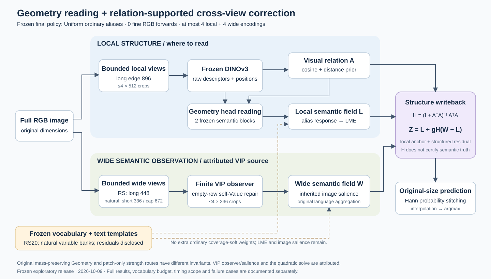

# Geometry: frozen structure-guided open-vocabulary segmentation

2026-10-18更新：新增 **Qwen20→VIP paper-rule** 的 8 个遥感协议全量筛词与验证。每类使用 canonical＋19 个 Qwen 文本候选，VDD、Potsdam、Vaihingen 也不回退到 VIP 官方词表；VG/SC 在全部无标签评测图像上冻结后，再报告 `VIP_All20` 与 `VIP_Distilled`。结果、逐类保留数、成本和 transductive 边界见 [Qwen20→VIP报告](research/qwen20_vip_paper_20261018/REPORT_ZH.md)，对比词表见 [qwen20_vip_20261018](vocabularies/qwen20_vip_20261018/README.md)。

2026-10-14更新：完成 **COCO-Object81全量5,000张、99配置的最佳g0与部件消融**，见[完整报告、全步长表及逐图证据](research/geov2_coco81_bestg_ablation_20261014/REPORT_ZH.md)。扫描8档后Full最佳g0=0.5，mIoU=49.6209%；同g0下QuerySlot净差+0.1448pp、DonorBefore +0.0167pp、前景扩词+0.8407pp。允许各对照重选g0后，不能声称所有主部件均优于替代方案。全部三份已完成0.5消融的事后等域汇总中，四项平均差的区间均高于0，单域不确定性仍保留。Full为153.40ms／2722.19MiB allocated。g0使用已查看验证标签选择，属于开发分析。

2026-10-14更新：完成 **VOC21全量1,449张、固定g0=0.5的QuerySlot复核及13项部件消融**，见[完整报告与逐图证据](research/geov2_voc21_fixed05_ablation_20261014/REPORT_ZH.md)。Full为72.1656%，关闭query路由为71.0325%，净收益+1.1331pp，配对95%区间[+0.8550,+1.4184]；DonorBefore贡献+0.1958pp，保留背景不变的前景扩词+4.0839pp。Full为142.47ms／2247.24MiB allocated。同观测等权融合74.8935%高于固定0.5结构写回，UDD5路由净差也仍保留；不宣称各部件在所有域都获益。词表、背景校准及g0在本轮均未搜索。

2026-10-14更新：完成 **UDD5全量40张、固定g0=0.5的部件消融**，见[完整报告、配对区间与成本](research/geov2_udd5_fixed05_ablation_20261014/REPORT_ZH.md)。QuerySlot＋DonorBefore Full为55.2574%、288.20ms／2276.79MiB；DonorBefore贡献+0.4664pp，前景扩词+5.8546pp，结构写回相对等权融合+12.6799pp。关闭query路由反而为55.5846%，Raw32坐标读出为55.7592%，因此不宣称QuerySlot在UDD5上必需。补充同观测H控制表明Full较固定减幅融合高0.5740pp；视觉关系相对纯空间关系的额外收益区间仍跨0。所有词表、配置、逐图统计和独立成本记录均公开，历史主表不混用。

2026-10-14更新：**Geov2 十协议固定写回 g0 全量扫描完成，PC60 替换 LandCover.ai**。最佳 Alias + QuerySlot + DonorBefore 下，统一 g0=0.5 的等协议平均为 **55.8158%**，较等权融合 **+3.1730pp（7/10协议领先）**；逐域最优参考为56.7433%，统一步长代价0.9275pp，VOC21代价最大3.0438pp。全部留一选择及VOC20/21共同留出均选0.5；其他历史任务参数仍非全局统一。见[中文记录与完整步长表](research/geov2_g0_sweep_20261014/REPORT_ZH.md)、[审计与配对区间](research/geov2_g0_sweep_20261014/REPORT.md)、[完整模型说明](docs/GEOV2_FIXED_WRITER_20261014.md)及[四域自适应候选全量消融](research/geov2_full_ablation_20261014/REPORT.md)。三种Alias接口均扫描，逐图统计与可选统一步长配置一并保留；自适应不作为默认最终写回。

2026-10-13更新：发布 **QuerySlot＋DonorBefore 完整模型实现及15数据集／16协议全量对比**。见[模型与复现说明](docs/QUERY_SLOT_DONOR_BEFORE_20261013.md)、[精度／耗时／显存对比表](research/query_slot_best_alias_20261013/REPORT.md)、[机器可读结果](research/query_slot_best_alias_20261013/RESULTS.csv)。采用此前带标签开发搜索保留的最佳alias，两个模块全部实际执行：7个协议精度提升、9个下降；耗时比旧Efficient记录减少3.65%–29.79%，显存有升有降。局部strength统一为`original`，因此部分协议同时改变了局部路径；不将全部差值归于宽视野替换。2026-10-09论文冻结主表仍单独保留。

2026-10-12更新：五个公开方法的全部 **75 项全量评测＋75 项耗时／显存测试已完成**，覆盖 226,000 次协议图像评测。见[复现协议与运行说明](docs/BASELINE_BENCHMARK_20261011.md)、[完整对比表](research/TRAINING_FREE_BASELINES_FULL_20261011.md)和[核验证据](research/training_free_baselines_full_20261011/verification.json)。CorrCLIP 在 PC59／PC60 上超过当前 Geometry 历史参考；保留这些结果及资源、配置与选择协议的差异。

2026-10-10更新：新增当前Kev开发选择后的冻结模型、15协议的实际alias与YAML，以及无需历史实验缓存的[独立推理／评测入口](docs/DEPLOYMENT_20261010.md)。原2026-10-09模型和实验记录保留在下面，不能将两版结果混用。最新精度见[Kev完整结果](research/KEV_ALIAS_SEARCH_20261009.md)和[相同词表VIP对照](research/VIP_KEV_SAME_VOCABULARY_20261010.md)，执行优化与验证见[效率报告](research/COMPACT_DEPLOYMENT_20261010.md)。

```bash
python DINOtool/scripts/infer_frozen_geometry.py --help
python DINOtool/scripts/evaluate_frozen_geometry.py --help
```

当前配置是带标签开发选择后的任务特定配置；Kev只在离线词表判断中使用，单图分割不加载Kev。词表不是每类强制20个，VDD/Potsdam采用规范化解析的官方短词；不要将所有收益归为Kev筛词。精确历史二进制文本缓存不纳入Git，独立入口从词表重新编码并记录本机缓存身份，浮点并列处可能与历史缓存有细小差异。

以下为2026-10-09原版研究快照。该版冻结终版为 **Geometry局部读取＋VIP来源的宽视野观测＋Geometry关系支持的耦合写回**。原版主入口为 `TaxonomyInference.for_finalization(..., ordinary_alias_policy="uniform")`；2026-10-10部署配置使用上面的独立入口。



这份仓库同时保存最终代码和探索历史。旧实验模块仍在源码中，但不代表全部属于终版；`DINOtool/README.md`是早期工具箱说明，其默认DinoSplat/训练适配/SAM等路线不是这里的最终模型。以本页、冻结配置与下列说明为准。

## 阅读入口

| 内容 | 文档 |
| --- | --- |
| 终版框架、公式、职责与创新边界 | [架构说明](docs/ARCHITECTURE.md) |
| Geov2 中文完整流程：从双视野输入到结构写回 | [方法全流程](docs/GEOV2_METHOD_ZH_20261014.md) |
| 筛词／降权尝试、证据与取舍 | [Alias实验综述](docs/ALIAS_STUDY.md) |
| 全量精度、VIP对比、速度和显存 | [完整实验表](docs/RESULTS.md) |
| 环境、模型入口、数据与复现要求 | [复现说明](docs/REPRODUCIBILITY.md) |
| 历史报告和筛词代码的完整索引 | [实验与源码索引](docs/EXPERIMENT_INDEX.md) |
| 完整终版原始分析 | [最终模型报告](research/CVPR_FINAL_MODEL_20261009.md) |
| UDD5／VOC21 强优势定性对比 | [定性对比页](docs/QUALITATIVE_COMPARISONS_20261014.md) |
| 词表、模板、参数与选择标准 | [protocol.json](research/alias_finalization_20261009/protocol.json) |
| 最终策略和比较来源 | [final_model.json](research/alias_finalization_20261009/final_model.json) |

## 原版结果（2026-10-09）

- 八遥感全量20,092图：终版等域平均 **49.1833 mIoU**，较强已测VIP参考 **44.0039**，差 **+5.1794pp**，八域均领先该参考。LoveDA主均值只计D一次，P另报。
- 同观测等权logit融合为 **46.9965**；结构耦合提升 **+2.1869pp**，条件95%配对区间 **[+2.0106,+2.3440]**。
- 自然图像没有全面超过VIP：ADE150为 **31.1862 vs 29.1387**；VOC21为 **70.4508 vs 73.2591**；COCOObject81为 **44.2396 vs 48.9955**。全部结果与缺失比较均保留。
- 整图抽样中位延迟 **185.30–368.71ms**，约 **1.717–3.231×VIP**；峰值allocated **5514.66–6538.80MiB**。每协议7图×7次独立进程同步计时，不是全数据集平均延迟。

## Alias最终决定

关闭额外普通局部coverage-soft重分配，保留原局部LME和宽视野图像salience。关闭后主要四域平均代价 **0.0422pp**，最差迁移入口代价 **0.1497pp**，通过预先冻结的实际简化门槛。软权重并非完全无用，但不足以证明“识别有害alias”。原Retained代码和全部结果保留；没有按域挑选权重开关。

Uniform不等于各词实际影响相同：LME的响应导数与softmax责任成正比，宽视野已有图像条件salience。自然普通前景两臂本来相同，不能用它们相等证明词处理泛化。PC60的额外401残余概念与protected rule另行保留和披露。

## 比较与投稿边界

VIP为本地、明确修复全mask attention行后的实现测量，不是认证的论文数字。VDD/Potsdam/Vaihingen使用官方短词；另外五个遥感域是外部20词及论文规则蒸馏适配。旧NaN污染或旧Vaihingen输入下的低分不作为主比较。

全部15协议共45,200次图像评测；VOC20/21和PC59/60共享来源，不能称45,200个独立图像。LandCover.ai代替未获得可评分标签的iSAID；Cityscapes未纳入。既有词表和配置参与过有标签开发，冻结重跑不等于独立测试。

论文主线是视觉关系组织局部读取和限制跨视野修正写回。明确归属VIP观测/salience与经典二次解；不把现有alias启发式、变长词表支持或所有历史算子都当作新贡献。最终任务路线的最近算子公平对照、独立来源验证及空间机制证据仍是投稿缺口。

## 仓库范围

`DINOtool/dinotool`保存实现，`DINOtool/scripts`保存评测／诊断／统计脚本，`DINOtool/tests`保存测试；`research`保存相关原始报告、冻结配置、汇总混淆矩阵和计时证据。`RELEASE_MANIFEST.json`列出快照内容。

权重、数据集、二进制文本缓存和本机SSH管理配置不纳入Git。本轮39份逐图TP／target／predicted统计NPZ随实验公开，不含RGB或mask。第三方实现与checkpoint遵循各自上游条件，来源见[复现与归属](docs/REPRODUCIBILITY.md)。

2026-10-14更新：Geov2 保留 **最佳 Alias + QuerySlot + DonorBefore + 固定结构写回 Z=L+g0 H(W−L)**；自适应 gate 为候选消融。已完成的四域全量中，自适应比固定写回的等域平均仅高0.0690pp，因此不宣称其普遍最优。完整流程、实际 FP64 二次目标和 Alias 处理见 [固定写回说明](docs/GEOV2_FIXED_WRITER_20261014.md)。最新十协议 g0 扫描单独记录，PC60 替换 LandCover.ai，不与旧四域不同 strength 的结果混用。
