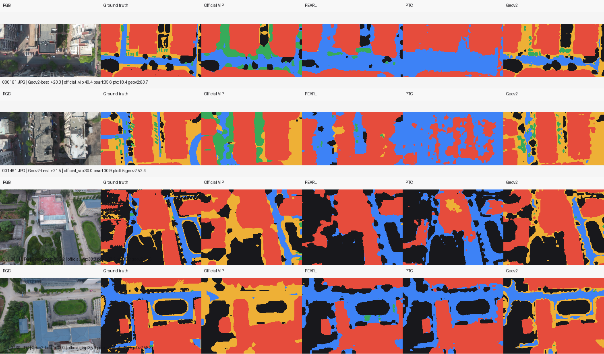
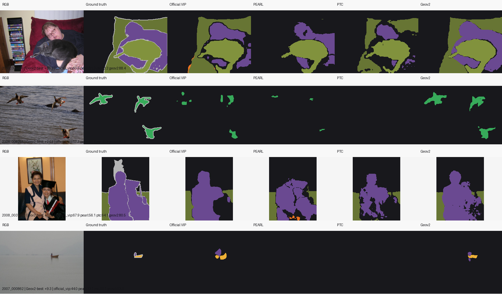
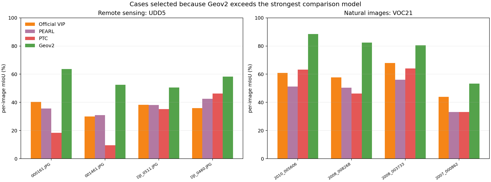

# Geov2 定性对比：UDD5 与 VOC21（2026-10-14）

本页把外部比较中的 `VIP wide` 更正为**官方 VIP 完整复现**。`VIP wide` 是 Geov2 内部宽视野端点，未经过局部结构写回，只能作为内部消融；它不再作为对外 baseline。每个数据集从同一批 16 张候选图中自动选择四张，评分规则为：

```text
Geov2 单图 mIoU − max(Official VIP, PEARL, PTC)
```

所有方法使用同一 RGB、同一 ground truth 和同一类别调色板。每行列顺序为 RGB、Ground truth、Official VIP、PEARL、PTC、Geov2。官方 VIP 的实现固定在上游 commit `5bd25ee03ec25c1538622cf7da661e8c0461e769`；逐图运行签名见 [`UDD5`](qualitative_20261014/official_vip/udd5/signature.json) 和 [`VOC21`](qualitative_20261014/official_vip/voc21/signature.json)。

## 遥感：UDD5

UDD5 的四张图分别领先最强对照 **+23.3、+21.5、+12.2、+12.0pp**。

| 图像 | Official VIP | PEARL | PTC | Geov2 | Geov2 margin |
|---|---:|---:|---:|---:|---:|
| `000161.JPG` | 40.4 | 35.6 | 18.4 | **63.7** | **+23.3** |
| `001461.JPG` | 30.0 | 30.9 | 9.5 | **52.4** | **+21.5** |
| `DJI_0511.JPG` | 38.3 | 38.2 | 35.2 | **50.5** | **+12.2** |
| `DJI_0460.JPG` | 35.9 | 42.5 | 46.3 | **58.3** | **+12.0** |



## 自然图像：VOC21

VOC21 的四张图分别领先最强对照 **+25.2、+24.8、+12.6、+9.3pp**，其中保留用户指定的 `2007_000862`。

| 图像 | Official VIP | PEARL | PTC | Geov2 | Geov2 margin |
|---|---:|---:|---:|---:|---:|
| `2010_005606` | 60.9 | 51.3 | 63.2 | **88.4** | **+25.2** |
| `2008_008268` | 57.7 | 50.4 | 46.3 | **82.5** | **+24.8** |
| `2008_003733` | 67.9 | 56.1 | 64.1 | **80.5** | **+12.6** |
| `2007_000862` | 44.0 | 33.1 | 33.1 | **53.3** | **+9.3** |



## 遥感候选集搜索记录

本次官方 VIP 修正后的展示集只使用 UDD5 的 16 张候选图；前四名及精确数值见 [`remote_dataset_search.json`](qualitative_20261014/remote_dataset_search.json)。此前 Potsdam/Vaihingen 的搜索记录使用了 Geov2 内部 `VIP wide` 端点，因此没有纳入本页的外部 baseline 结论。



逐图 JSON：[`UDD5`](qualitative_20261014/udd5/strong_cases.json)、[`VOC21`](qualitative_20261014/voc21/strong_cases.json)。这些图用于定性展示，完整数据集结论仍以全量 mIoU 表为准。
