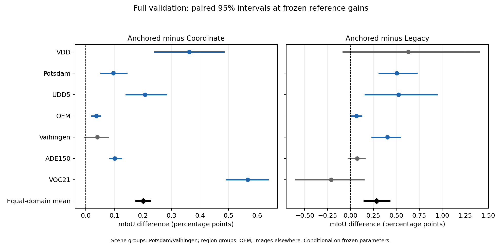
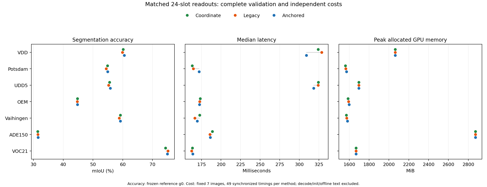

# 空间锚定宽视野实验

总体状态：**complete**。

本分支固定 **Anchored** 为 Geov2 终版架构。这里的“固定”指终版实现和视觉模块不再在候选之间切换；它不把历史上按协议开发得到的词表、背景规则和校准参数改写成统一无调参协议。完整的来源和允许调参边界见 [终版调参口径](../GEOV2_FINAL_MODEL_AND_TUNING_POLICY_20261016.md)。

Anchored 本轮没有根据自己的 mIoU 重新选择 alias；七个协议沿用开跑前已冻结的词表快照。词表和部分校准历史上曾使用带标签开发过程，因此主结果应称为“冻结任务语言协议下的视觉模块比较”。

| 阶段 | 状态 | 已完成数据集 |
| --- | --- | --- |
| [smoke](smoke/REPORT_ZH.md) | complete | vdd, potsdam, udd5, oem, vaihingen, ade150, voc21 |
| [full](full/REPORT_ZH.md) | complete | vdd, potsdam, udd5, oem, vaihingen, ade150, voc21 |

## 完整验证集：相同参考g0

单位为mIoU%。所有方法共享局部DonorBefore、24槽语义头、Alias、计分及背景规则。普通加权融合独立选取alpha；其余各行使用表中相同g0。

| 配置 | VDD | Potsdam | UDD5 | OEM | Vaihingen | ADE150 | VOC21 |
| --- | ---: | ---: | ---: | ---: | ---: | ---: | ---: |
| 图像数 | 80 | 504 | 40 | 384 | 113 | 2000 | 1449 |
| g0 | 1 | 0.5 | 0.5 | 0.25 | 0.25 | 0.25 | 1 |
| Coordinate | 60.1696 | 54.8613 | 55.5989 | 44.7603 | 59.1831 | 31.4642 | 74.4098 |
| Legacy | 59.9018 | 54.4523 | 55.2819 | 44.7328 | 58.8200 | 31.4922 | 75.1860 |
| Anchored | 60.5318 | 54.9576 | 55.8063 | 44.7973 | 59.2232 | 31.5649 | 74.9766 |
| NoPrior | 59.9973 | 54.8595 | 55.7212 | 44.7436 | 59.1955 | 31.4769 | 74.6310 |
| NoReference | 60.4049 | 55.2748 | 55.8452 | 44.8022 | 59.4011 | 31.5982 | 74.6618 |
| AbsoluteMix | 60.0474 | 54.4721 | 55.3313 | 44.7540 | 58.8827 | 31.5239 | 75.2359 |
| Shuffled | 56.5999 | 52.0580 | 54.2724 | 44.6455 | 58.2828 | 30.1348 | 64.4297 |
| 最佳普通加权融合 | 59.6304 | 54.9757 | 55.3790 | 44.6972 | 59.1166 | 31.3839 | 74.2921 |

## 主要配对比较

| 对照 | Anchored平均净收益pp | 分组配对95%区间 | 正/负点估计域数 |
| --- | ---: | --- | ---: |
| Coordinate | +0.2015 | [+0.1765, +0.2262] | 7/0 |
| Legacy | +0.2844 | [+0.1515, +0.4275] | 6/1 |

## 各自相同预算选择g0

三个核心方法均在{0.25,0.5,0.75,1}中各自选择。这是开发标签上的最佳配置分析，不能代替上面的冻结参考步长结论。

| 数据集 | Coordinate最佳g0 / mIoU | Legacy最佳g0 / mIoU | Anchored最佳g0 / mIoU |
| --- | ---: | ---: | ---: |
| VDD | 1 / 60.1696 | 1 / 59.9018 | 1 / 60.5318 |
| Potsdam | 0.75 / 55.2080 | 0.75 / 54.4849 | 0.75 / 55.4893 |
| UDD5 | 0.5 / 55.5989 | 0.5 / 55.2819 | 0.5 / 55.8063 |
| OEM | 0.25 / 44.7603 | 0.25 / 44.7328 | 0.25 / 44.7973 |
| Vaihingen | 0.25 / 59.1831 | 0.25 / 58.8200 | 0.25 / 59.2232 |
| ADE150 | 0.25 / 31.4642 | 0.25 / 31.4922 | 0.25 / 31.5649 |
| VOC21 | 1 / 74.4098 | 1 / 75.1860 | 1 / 74.9766 |

## 所有数据集共用一个g0

只使用已声明并完成的四个步长，不新增评测。每个数据集等权，以下为各域mIoU的算术平均；不是把所有图像合并后的mIoU。

| 统一g0 | Coordinate平均mIoU | Legacy平均mIoU | Anchored平均mIoU |
| ---: | ---: | ---: | ---: |
| 0.25 | 50.5066 | 50.6579 | 50.5728 |
| 0.5 | 53.2231 | 53.1242 | 53.4065 |
| 0.75 | 53.0746 | 52.4156 | 53.3778 |
| 1 | 51.1378 | 50.0510 | 51.5506 |

| 方法 | 最佳统一g0 | 七域平均mIoU |
| --- | ---: | ---: |
| Coordinate | 0.5 | 53.2231 |
| Legacy | 0.5 | 53.1242 |
| Anchored | 0.5 | 53.4065 |

最佳统一g0用完整开发标签选择，是减少逐域参数的开发分析；不是未查看测试集上的结论，也不改变冻结参考g0的模型替换判定。

## 是否替换当前模型

**未达到预声明替换条件。**

以下条件在新评测前声明。精度按冻结参考g0判断；成本基线为同配置Legacy，要求七个数据集全部满足。Coordinate成本同时报告，作为更简单的替代方案。

| 条件 | 实测 | 预声明要求 | 状态 |
| --- | ---: | --- | --- |
| 平均优于Coordinate | +0.1765 | grouped paired macro 95% lower bound > 0 pp | 通过 |
| 平均优于Legacy | +0.1515 | grouped paired macro 95% lower bound > 0 pp | 通过 |
| VOC21相对Legacy不劣 | -0.5991 | paired 95% lower bound > -0.2 pp | 未通过 |
| Potsdam不退化 | +0.0962 | reference-gain point improvement >= 0 pp | 通过 |
| Vaihingen不退化 | +0.0401 | reference-gain point improvement >= 0 pp | 通过 |
| 最差域时延比 | +1.0447 | all datasets: Anchored / Legacy median latency <= 1.05 | 通过 |
| 最差域allocated增量 | +7.7085 | all datasets: Anchored - Legacy peak allocated <= 50 MiB | 通过 |

未通过的条件：VOC21相对Legacy不劣。保留本轮候选及负结果；当前证据不支持按预声明规则替换原模型。

这些是开发阶段的替换条件，不是CVPR录用或创新性的充分条件。区间条件于历史开发配置，不能据此声称独立测试泛化；未测LPOSS等方法的优劣仍未知。

## 独立成本

成本状态：complete。缺失项不会填入推测值。

单位为ms与MiB；allocated、reserved均不是nvidia-smi驻留显存。固定7图，每图2次预热、7次同步测量，49次合并中位数；CPU RGB tensor到原尺寸CPU uint8标签，排除解码、初始化及离线文本编码。

| 数据集 | 方法 | ms | allocated MiB | reserved MiB |
| --- | --- | ---: | ---: | ---: |
| VDD | Anchored | 308.94 | 2063.89 | 2188.00 |
| VDD | Coordinate | 323.95 | 2063.89 | 2186.00 |
| VDD | Legacy | 328.56 | 2063.89 | 2186.00 |
| Potsdam | Anchored | 171.97 | 1572.68 | 1682.00 |
| Potsdam | Coordinate | 163.17 | 1560.79 | 1702.00 |
| Potsdam | Legacy | 164.61 | 1564.98 | 1702.00 |
| UDD5 | Anchored | 318.40 | 1696.57 | 2026.00 |
| UDD5 | Coordinate | 324.18 | 1697.63 | 2026.00 |
| UDD5 | Legacy | 324.03 | 1697.37 | 2026.00 |
| OEM | Anchored | 172.51 | 1598.64 | 1722.00 |
| OEM | Coordinate | 173.37 | 1588.56 | 1722.00 |
| OEM | Legacy | 172.69 | 1592.37 | 1722.00 |
| Vaihingen | Anchored | 169.64 | 1581.64 | 1704.00 |
| Vaihingen | Coordinate | 172.78 | 1571.56 | 1704.00 |
| Vaihingen | Legacy | 166.49 | 1575.37 | 1704.00 |
| ADE150 | Anchored | 186.27 | 2872.10 | 5842.00 |
| ADE150 | Coordinate | 188.97 | 2872.44 | 5822.00 |
| ADE150 | Legacy | 185.85 | 2872.13 | 5822.00 |
| VOC21 | Anchored | 163.98 | 1669.35 | 1810.00 |
| VOC21 | Coordinate | 163.46 | 1669.35 | 1810.00 |
| VOC21 | Legacy | 162.37 | 1669.35 | 1810.00 |

## 完整验证集图表

矢量版：[配对区间PDF](paired_readout_intervals.pdf)、[精度与成本PDF](core_accuracy_cost.pdf)。

筛查子集、冒烟和完整验证集分开报告，全部负结果保留。配对分组区间、同预算最优g0以及五折标量选择见[完整报告](full/REPORT_ZH.md)。

机器汇总：[SUMMARY.json](SUMMARY.json)；全部精度：[ALL_RESULTS.csv](ALL_RESULTS.csv)；成本：[COST_RESULTS.csv](COST_RESULTS.csv)。
