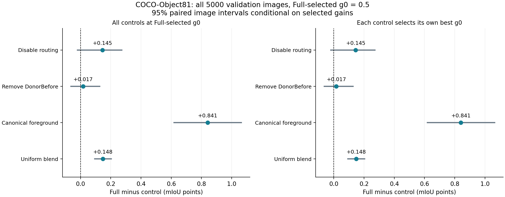
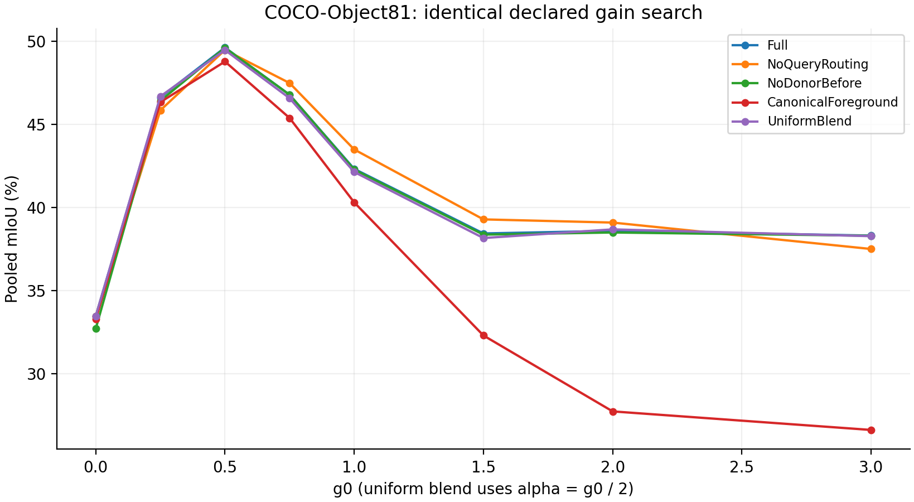

# COCO-Object81：最佳g0与各部件全量消融

**完整模型最佳g0=0.5，mIoU=49.6209%，A800中位耗时153.40ms，峰值allocated 2722.19MiB。**

四个主部件的点估计均为正，但部分配对区间跨0，尚不能确认每个部件都有稳定净收益。 允许各对照独立重选g0后，不能声称每个部件都优于其替代方案。

完整验证集5,000张、81类；12种耦合配置各扫描g0∈{0,0.25,0.5,0.75,1,1.5,2,3}，再加等权融合与两个端点，共99项配置。未改变历史alias、beta、温度、背景bias或阈值。本轮选择COCO以使用独立于VOC的图像来源及多物体场景，不对新数据集做轮番筛选后只报告获胜者。

g0由全量验证标签选出，是开发分析，不是测试集上无标签自动选择。推理读取冻结g0，不读取标签。区间为5,000次配对图像bootstrap，条件于已经选好的g0，没有嵌套选择或多重比较校正；不能将其视为独立泛化证据。

## 1. 完整模型及对照定义

Full = 冻结official_imagenet词表＋局部DonorBefore（strength=original）＋raw-query QuerySlot24（beta=0.5，温度0.1）＋Z=L+g0H(W−L)，H=(I+AᵀA)⁻¹AᵀA。两路共享类别映射；QuerySlot以局部raw token从整图槽库读上下文，H限制修正写回。
当前词表共156词，背景32词；前景仅类名的控制共112词，背景完全保留。消融删除的是前景扩展词，保留同一模板、类别映射与背景校准。
NoQueryRouting仅beta=0，保留相同槽数及先采样特征再计分的顺序；NoDonorBefore只关闭局部响应顺序干预；CanonicalForeground只删除前景扩展词，背景词表不变。ShuffledQuery将局部query循环移位512位，保留token多重集合。
LocalOnly与WideOnly只改变同观测读出。WideOnly中的W仍受局部query条件化，不能当成删除局部编码器后的独立整图模型。
UniformBlend将H换成0.5I，对应Z=(1−alpha)L+alphaW，alpha=g0/2；其8档包含等权融合与alpha=1.5的超松弛。DiagonalH只保留H的对角线，检验跨位置关系的作用。它们共享Full的L/W，并各自扫描同一g0网格。Raw24/32还改变采样与计分顺序，不能把其差值全归于query路由。LegacyDonorVIPWide只替换内部宽视野分支，不是官方完整VIP基线。

## 2. 在完整模型最佳g0下删除部件

| 配置 | g0 | mIoU % | Full−对照 pp | 配对95%区间 pp |
| --- | ---: | ---: | ---: | --- |
| Full | 0.5 | 49.6209 | +0.0000 | [+0.0000, +0.0000] |
| NoDonorBefore | 0.5 | 49.6042 | +0.0167 | [-0.0635, +0.1270] |
| NoQueryRouting | 0.5 | 49.4760 | +0.1448 | [-0.0199, +0.2727] |
| NoDonorNoRouting | 0.5 | 49.4212 | +0.1997 | [+0.0335, +0.3579] |
| ShuffledQuery | 0.5 | 47.0470 | +2.5738 | [+2.2875, +2.8294] |
| CanonicalForeground | 0.5 | 48.7801 | +0.8407 | [+0.6189, +1.0645] |
| WideCountNormalized | 0.5 | 48.4426 | +1.1783 | [+0.8763, +1.4427] |
| Raw24CoordinateGrid | 0.5 | 49.5448 | +0.0761 | [-0.1492, +0.2437] |
| Raw32CoordinateGrid | 0.5 | 49.5370 | +0.0838 | [-0.1443, +0.2530] |
| LegacyDonorVIPWide | 0.5 | 49.7094 | -0.0886 | [-0.3848, +0.1364] |
| UniformBlend | 0.5 | 49.4730 | +0.1479 | [+0.0931, +0.2037] |
| DiagonalH | 0.5 | 34.8962 | +14.7247 | [+13.2619, +15.4087] |
| EqualLogitFusion | — | 42.1355 | +7.4853 | [+6.8752, +8.2221] |
| LocalOnly | — | 33.4590 | +16.1618 | [+14.7019, +16.8583] |
| WideOnly | — | 38.6802 | +10.9407 | [+10.2612, +11.8944] |

## 3. 允许删除部件后的对照也重选最佳g0

这张表检查收益是否主要来自只给完整模型选好步长。各行都按同一8档网格最大化整个验证集累计混淆矩阵的mIoU；不是逐图选参数。负差或区间跨0的项均保留。

| 配置 | 各自最佳g0 | 最佳mIoU % | Full最佳−对照最佳 pp | 配对95%区间 pp |
| --- | ---: | ---: | ---: | --- |
| Full | 0.5 | 49.6209 | +0.0000 | [+0.0000, +0.0000] |
| NoDonorBefore | 0.5 | 49.6042 | +0.0167 | [-0.0635, +0.1270] |
| NoQueryRouting | 0.5 | 49.4760 | +0.1448 | [-0.0199, +0.2727] |
| NoDonorNoRouting | 0.5 | 49.4212 | +0.1997 | [+0.0335, +0.3579] |
| ShuffledQuery | 0.5 | 47.0470 | +2.5738 | [+2.2875, +2.8294] |
| CanonicalForeground | 0.5 | 48.7801 | +0.8407 | [+0.6189, +1.0645] |
| WideCountNormalized | 0.5 | 48.4426 | +1.1783 | [+0.8763, +1.4427] |
| Raw24CoordinateGrid | 0.5 | 49.5448 | +0.0761 | [-0.1492, +0.2437] |
| Raw32CoordinateGrid | 0.5 | 49.5370 | +0.0838 | [-0.1443, +0.2530] |
| LegacyDonorVIPWide | 0.5 | 49.7094 | -0.0886 | [-0.3848, +0.1364] |
| UniformBlend | 0.5 | 49.4730 | +0.1479 | [+0.0931, +0.2037] |
| DiagonalH | 3 | 40.4494 | +9.1715 | [+7.8357, +9.7946] |

## 4. 结果如何写进论文

四个主部件的点估计均为正，但部分配对区间跨0，尚不能确认每个部件都有稳定净收益。
允许各对照独立重选g0后，不能声称每个部件都优于其替代方案。
可以报告对应配置、数据集与选择协议下的部件贡献。不能因为希望得到完整故事，就将重选g0后更好的对照、UDD5的路由结果或VOC21固定0.5低于等权融合的结果删掉。单域正向消融也不意味着该部件对所有域必需。
本轮Alias控制检验保留背景不变的前景扩词，不单独证明Kev筛词有效。当前official_imagenet bank的来源和实际词表一起公开；如果没有同来源、同模板、同背景的未筛候选池，不把扩词收益称为筛词收益。

结构本身的净证据应看最佳普通加权融合对照：Full比其高0.1479pp，区间[+0.0931, +0.2037]，其最佳alpha=0.25。Full相对等权融合的大差值还包含融合步长的影响，不能全部归于结构滤波。

### 已完成三域的事后平均分析

为检查部件的平均贡献，纳入目前全部三份完整匹配消融：UDD5（40图）、VOC21（1,449图）、COCO（5,000图），不删除任何域或任何负向单域结果。三份都使用已完成的g0=0.5记录，按数据集等权平均，独立在域内重采样图像且各方法保持配对。
这是看到COCO结果后的事后分析；不是预注册主检验、独立测试、逐域最佳g0表或每域均改善的证明。VOC21沿用此前固定0.5消融，未改成其历史最优1。区间只描述这三份固定记录的图像不确定性，不包括数据集抽样及历史参数选择的不确定性。

| 删除或替换部件 | Full−对照的等域平均 pp | 配对95%区间 pp |
| --- | ---: | --- |
| NoQueryRouting | +0.3169 | [+0.1296, +0.4767] |
| NoDonorBefore | +0.2263 | [+0.1592, +0.3030] |
| CanonicalForeground | +3.5931 | [+2.8845, +4.3284] |
| EqualLogitFusion | +5.8124 | [+4.9134, +6.7410] |

三域平均四项区间均高于0，支持这三份记录上的平均贡献为正；COCO单域QuerySlot与DonorBefore区间跨0的结论仍保留。原始来源与重采样定义见[CROSS_DATASET_COMPONENTS.json](CROSS_DATASET_COMPONENTS.json)。

## 5. 独立成本

| 配置 | g0 | 中位耗时 ms | 峰值allocated MiB | 峰值reserved MiB |
| --- | ---: | ---: | ---: | ---: |
| Full | 0.5 | 153.40 | 2722.19 | 4168.00 |
| NoDonorBefore | 0.5 | 151.08 | 2722.19 | 4234.00 |
| NoQueryRouting | 0.5 | 152.34 | 2722.19 | 4168.00 |
| ShuffledQuery | 0.5 | 155.15 | 2722.19 | 4168.00 |
| Raw24CoordinateGrid | 0.5 | 144.14 | 2569.12 | 3732.00 |
| Raw32CoordinateGrid | 0.5 | 147.05 | 2569.12 | 3732.00 |
| LegacyDonorVIPWide | 0.5 | 220.13 | 2620.28 | 3822.00 |

每项独立进程，在全量精度作业结束后顺序运行。7张预先固定图，每图2次预热和7次同步重复，表内是49次的合并中位数。边界为CPU float RGB到原尺寸CPU uint8类ID，排除图像解码、初始化、离线文本编码和mask。allocated与reserved都不是nvidia-smi驻留显存；NoQueryRouting仍计算不混入输出的路由中间量，成本不是彻底移除该计算的优化下限。99配置扫描的墙钟耗时不代表单次推理延迟。

## 6. 核验和复现

全量5,000张唯一覆盖，7分片配置一致，每图TP/predicted/target之和与每项完整混淆矩阵逐一一致，标签支持数与旧全量扫描相同。Full在参考g0=0.5下的旧结果复现差为-0.000061pp；接口同观测差0像素，UniformBlend(g0=1)与等权融合差0像素。
配置与词表位于configs/、vocabularies/；[冻结协议](protocol.json)声明搜索空间，[selection.json](selection.json)记录标签选择及各行选出的g0。历史alias和背景校准使用过开发标签，且验证集此前已查看；本轮不是独立测试。
代码：[评测](../../DINOtool/scripts/eval_geov2_component_gain_sweep.py)、[审计、配对统计与作图](../../tools/report_coco81_bestg_ablation.py)。在配置好DINOtool及固定上游依赖的环境中替换protocol内路径，设置PYTHONPATH包含DINOtool、DINOtool/scripts、固定DINO_Soars依赖，按full.sh运行分片；按cost.sh测量独立成本。统计脚本先--stage precision，--stage aggregate生成事后三域汇总，最后--stage finalize。已有评测输出拒绝覆盖。
证据：[SUMMARY.json](SUMMARY.json)、[全步长表](GAIN_SWEEP.csv)、[消融与成本CSV](RESULTS.csv)、[完整逐图统计](per_image_statistics.npz)、full/、cost/及实际运行source/。只发布统计，不发布图像、mask、权重、二进制文本cache或SSH管理配置。
