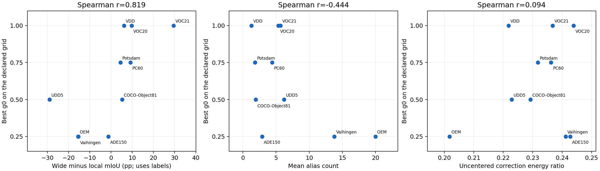

# g0 与观测可靠性、Alias 和分数刻度的关系

十协议中，7个最佳点在0.25/0.5/0.75，VDD、VOC20、VOC21的最佳点是1；这些是离散网格上的最优，不代表连续最优恰好等于这些数。若只保留前三个候选，逐域最优参考平均少0.1138pp，但会排除上述三域的最佳点。自适应候选范围宜保留到1。

| 协议 | 最佳g0 | Wide−Local mIoU pp | 平均Alias数 | 类别数 | 局部温度 | ||HΔ||/||Δ|| |
| --- | --- | --- | --- | --- | --- | --- |
| VDD | 1 | +6.12 | 1.29 | 7 | 0.07 | 0.471 |
| Potsdam | 0.75 | +4.47 | 1.83 | 6 | 0.07 | 0.481 |
| UDD5 | 0.5 | -28.91 | 6.20 | 5 | 0.05 | 0.472 |
| OEM | 0.25 | -15.52 | 20.00 | 8 | 0.03 | 0.449 |
| Vaihingen | 0.25 | -15.38 | 13.80 | 5 | 0.07 | 0.491 |
| PC60 | 0.75 | +9.17 | 4.40 | 60 | 0.07 | 0.486 |
| ADE150 | 0.25 | -1.21 | 2.89 | 150 | 0.14 | 0.493 |
| VOC20 | 1 | +9.72 | 5.35 | 20 | 0.1 | 0.494 |
| VOC21 | 1 | +29.53 | 5.67 | 21 | 0.07 | 0.487 |
| COCO-Object81 | 0.5 | +5.22 | 1.93 | 81 | 0.07 | 0.479 |

## 为什么多数协议需要阻尼，而不是直接走到Z*

固定结构目标为J(Z)=0.5||Z−L||²+0.5||A(Z−W)||²，H=(I+AᵀA)⁻¹AᵀA，D=H(W−L)，Z*=L+D。沿写回路径Z(g)=L+gD，有J(Z(g))=J(Z*)+0.5(g−1)²⟨D,(I+AᵀA)D⟩。因此只要D非零，这个固定目标本身总在g=1处最小，不能用它自动推出0.25/0.5/0.75。

实测mIoU在g<1处更高，说明语义正确性与该结构一致性目标存在偏差：W含有语义错误、背景偏置或刻度误差，H只筛选结构方向，不认证这些方向上的类别是否正确。阻尼可以减少错误修正越过分类边界的数量；过小又会留下局部混淆。若只是最小化同一个J来选步长，会恒选1，不能解决自适应问题。

Potsdam的0.75仅比0.5高0.0340pp，不能把离散最大值解释成该数据集必需0.75。相比之下，VOC21从0.5到1提高3.0438pp，UDD5从0.5到0.75下降3.6249pp；自适应更应关注这些敏感区间，并检查配对不确定性。

## 哪些因素最相关

| 描述量 | 与最佳g0的Spearman相关 |
| --- | --- |
| wide_minus_local_pp | 0.819 |
| mean_alias_count | -0.444 |
| alias_count_cv | 0.319 |
| correction_energy_ratio | 0.094 |
| classes | 0.028 |
| local_temperature | 0.222 |
| displacement_energy_per_patch_class | -0.281 |

端点优势相关为0.819，去掉任意一个协议后为0.773–0.892。这是同十协议上的描述，不是独立预测验证；VOC20/VOC21共源，最佳g0有大量并列，不能据此给出普遍因果结论。端点mIoU使用标签，不能用于无标签推理。

OEM/Vaihingen 的宽视野分别比局部低约15.5/15.4pp，适合小步长0.25；VOC21宽视野比局部高29.5pp，适合1。UDD5是重要例外：宽视野单独很弱，结构筛选后的差分仍有用，最佳为0.5。因此应估计被H保留的修正是否可信，而不是仅对两路做全局胜负判断。

类别数相关约0.028，不能按类别多寡选步长；遥感和自然的组平均都以0.5最好，也不能简单分成两个域规则。局部温度的跨域相关较弱，不代表缩放无影响：当前实验未控制其他因素去单独改变温度。

## Alias 是实测交互，不是单纯词数规则

count_normalized只去掉宽视野LSE的log(k_c)/tau，6/10协议最佳g0改变；UDD5由0.5变0，VOC21由1变0.5，PC60由0.75变0.5。OEM每类恰好20词，归一化仅去掉类别共同偏移，预测与最佳g0几乎不变。canonical还同时改变词义覆盖，不能用它单独识别词数效应。

g0同时补偿跨视野语义可靠性和现有分数校准。不同类别的Alias偏置会改变决策边界；固定温度和背景规则又决定宽视野差分能把多少像素推过边界。不能把当前最优g0讲成由图像内容唯一决定的常数。

## 为什么已有差分能量不能直接当gate

任意每个patch对所有类别共同加一个数，都不改变softmax及最终分割。H沿空间维作用，也不会打破这一不变性。令Π=I−11^T/C，应在LΠ、WΠ、H(W−L)Π上构造可靠性统计，避免与分类无关的共同偏移污染能量。此操作仅用于gate信号，保留现有写回logits和Alias语义。

现有记录是未做类别中心化的||HΔ||²/||Δ||²，和最佳g0相关仅0.094；OEM去掉相同词数偏置后，标签预测几乎不变，该能量比却由0.2018变为0.2302，直接说明它混入了预测无关的量。

H的有效收缩还意味着g0不是直接的宽视野融合权重。本轮||HΔ||/||Δ||约0.45–0.49；g0=0.5的修正RMS约为原差分的0.22–0.25。这只是未中心化的能量比，不能解释为每个像素固定22%–25%的宽视野占比。

## 自适应选择：可实现，但当前尚未证明优于固定0.5

旧四域gate在各自历史g0附近自适应，平均仅从59.8307到59.8997（+0.0690pp），且margin-only的平均更高。那轮Potsdam/VOC20的局部strength及VOC20词表与本轮不同，不能视为当前十域自适应的验证。

建议先做每窗口一个标量g(x)，候选范围[0.25,1]，以0.5为中性点。窗口内标量仍只缩放同一个D，被H完全阻断的方向仍不写入；逐像素对D乘不同gate一般不再保持这个子空间性质，需另作理论分析。保留原H和原始Alias读出，先在已有低分辨率class scores上估计三类无标签信号：去除共同分数偏移后的两路相对margin；模板子集的预测稳定性，尤其是结构修正D的方向是否稳定；局部query路由的稳定性及宽视野坐标读出与槽读出的分歧。优先切分模板而非Alias，避免把合理语义覆盖变化误判为不稳定，特别是VOC21的背景集合。每组保留同一批Alias，分组文本向量可离线缓存；局部RS6与宽视野模板不同，需要分别构造。熵、margin和稳定性只是代理，稳定的错误仍可能发生，不能直接当正确概率。

一个可检验的候选是在窗口内按||[H(W−L)Π]_i||加权汇总q_B=confidence_B×stability_B，r=(q_W−q_L)/(q_W+q_L+ε)，g=0.5+0.5·max(r,0)−0.25·max(−r,0)。两边质量相近时回到0.5，更信局部时趋向0.25，更信宽视野时趋向1。confidence应使用去除共同偏移并按分数尺度归一化的margin；stability需要额外记录，当前归档没有该逐图信号。这个映射是待验证的启发式，不是由现有二次目标推出来的最优步长。若修正权重全为0，回退到0.5即可，输出本来就不变。

应先验证这些信号能否在留出来源上预测不同步长的收益，再部署gate。不要用数据集名称查表，也不要用逐图标签选择g。VOC20/VOC21必须共同留出；与固定0.5、固定1、随机/打乱gate、常量均值gate和仅margin版本匹配比较。门槛是提高55.8158%的平均并改善VOC21的3.0438pp损失，同时披露其他域是否回退。

候选只增加patch级读出和O(NC)统计，不需要新RGB编码、SAM或再次求解H；仅最终选中的步长做密集写回。Alias/模板稳定性有额外读出成本，应独立测量，不能先宣称零耗时或零显存。所有全局gate参数需一次固定，并披露是否经过有标签开发选择。

## 按类别检查步长改变了什么

| 协议 | 对照 | IoU提升类数 | 下降类数 | 提升且TP增加 | 提升且FP减少 |
| --- | --- | --- | --- | --- | --- |
| VDD | 1 vs 0.5 | 5 | 2 | 3 | 4 |
| Potsdam | 0.75 vs 0.5 | 3 | 3 | 2 | 2 |
| OEM | 0.25 vs 0.5 | 5 | 3 | 4 | 1 |
| Vaihingen | 0.25 vs 0.5 | 5 | 0 | 3 | 2 |
| PC60 | 0.75 vs 0.5 | 32 | 28 | 27 | 12 |
| ADE150 | 0.25 vs 0.5 | 81 | 68 | 60 | 33 |
| VOC20 | 1 vs 0.5 | 17 | 3 | 10 | 14 |
| VOC21 | 1 vs 0.5 | 14 | 7 | 10 | 6 |

TP增加和FP减少两列可重叠。这些是汇总混淆矩阵的差值，非逐像素转移归因；具体类别见G0_ANALYSIS.json。选择的步长使用了全量标签，表仅用于机制解释。

