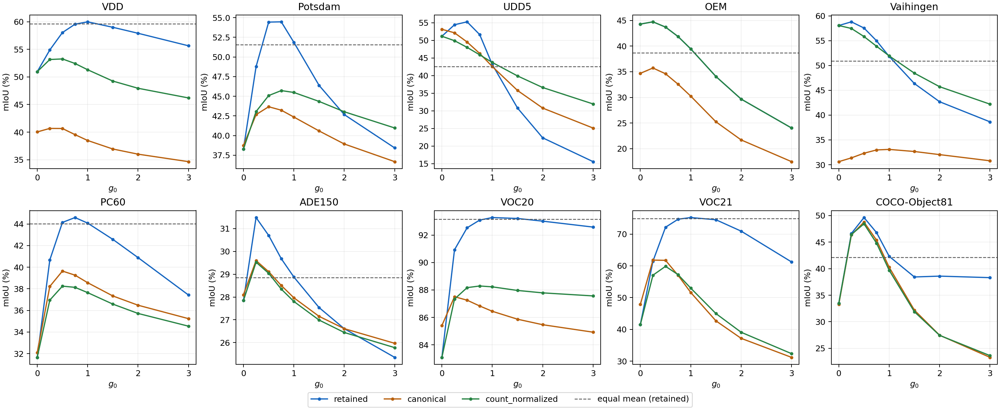
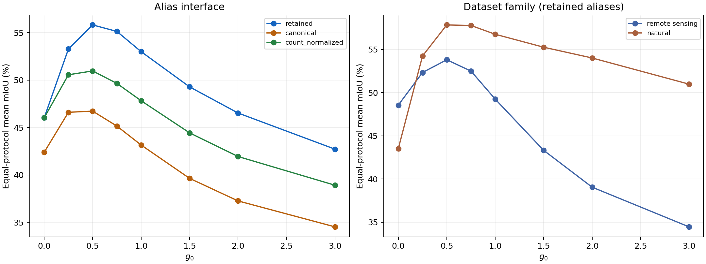

# Geov2：十协议固定结构写回步长扫描

全量完成，共 16,124 次协议图像评测。PC60 已替换 LandCover.ai。模型固定为 10/13 最佳 Alias + QuerySlot（24 槽）+ DonorBefore，所有局部 strength=original。

**统一最佳 g0=0.5，十协议平均 mIoU=55.8158%。** 每个数据集分别选最佳步长的参考上界为 56.7433%，统一步长少 0.9275pp。旧逐域步长在本轮配对观测上的平均为 56.6878%。

统一步长的最大单域损失出现在 VOC21，相对该域最优少 3.0438pp。选择统一步长应同时看这个损失，不能只看平均值。

统一步长比等权融合的十协议平均高 3.1730pp，胜出 7/10 个协议；VDD、VOC20、VOC21 仍低于等权融合，不能写成全部协议均超过融合。

| 数据集 | 0 | 0.25 | 0.5 | 0.75 | 1 | 1.5 | 2 | 3 | 等权融合 | 逐域最佳g0 |
| --- | --- | --- | --- | --- | --- | --- | --- | --- | --- | --- |
| VDD | 50.9434 | 54.8898 | 58.0367 | 59.5457 | 59.9781 | 58.9907 | 57.9078 | 55.6405 | 59.5918 | 1 |
| Potsdam | 38.2874 | 48.7679 | 54.4385 | 54.4724 | 51.8644 | 46.3901 | 42.6734 | 38.4350 | 51.5642 | 0.75 |
| UDD5 | 51.1651 | 54.4283 | 55.2567 | 51.6318 | 43.1212 | 30.7991 | 22.3378 | 15.5770 | 42.5750 | 0.5 |
| OEM | 44.2947 | 44.7354 | 43.7090 | 41.8539 | 39.4550 | 34.0712 | 29.6684 | 24.0278 | 38.7022 | 0.25 |
| Vaihingen | 58.0583 | 58.8018 | 57.5554 | 54.9732 | 51.8264 | 46.3648 | 42.6989 | 38.6462 | 50.9289 | 0.25 |
| PC60 | 31.6589 | 40.6747 | 44.1406 | 44.5929 | 44.0788 | 42.5743 | 40.8893 | 37.4295 | 44.0181 | 0.75 |
| ADE150 | 27.8471 | 31.4851 | 30.7014 | 29.6812 | 28.8769 | 27.5379 | 26.6112 | 25.3533 | 28.8492 | 0.25 |
| VOC20 | 83.0869 | 90.9307 | 92.5337 | 93.0960 | 93.2805 | 93.2139 | 93.0180 | 92.5851 | 93.1699 | 1 |
| VOC21 | 41.4698 | 61.4669 | 72.1656 | 74.6881 | 75.2094 | 74.5100 | 70.9306 | 61.2277 | 74.8929 | 1 |
| COCO-Object81 | 33.4590 | 46.6243 | 49.6209 | 46.7791 | 42.3194 | 38.4352 | 38.5930 | 38.3068 | 42.1360 | 0.5 |
| 十协议平均 | 46.0271 | 53.2805 | 55.8158 | 55.1314 | 53.0010 | 49.2887 | 46.5328 | 42.7229 | 52.6428 | 0.5 |

留一数据集选 g0 的平均为 55.8158%；将 VOC20/VOC21 共同留出时为 55.8158%。VOC20/VOC21 共用 1,449 张图，不能当作两份独立来源。逐域最优和全域最优都属于开发分析；留一只隔离 g0 的选择，不隔离历史 Alias、温度和背景校准的标签使用。

把 VOC20/VOC21 的平均作为一个组计权，九组平均的最佳 g0=0.5，mIoU=52.8676%。该项仅检查共源计权是否影响结论，主结果仍为十协议等权平均。

## 与数据集和 Alias 的关系

| 接口 | 统一最佳g0 | 最佳平均mIoU | 固定为retained最佳g0的平均 |
| --- | --- | --- | --- |
| retained | 0.5 | 55.8158 | 55.8158 |
| canonical | 0.5 | 46.7308 | 46.7308 |
| count_normalized | 0.5 | 50.9657 | 50.9657 |

count_normalized 仅去掉宽视野 class LSE 中的 log(alias_count)/tau，所有短语保留；canonical 每类只留第一条短语，模板不变。PC60 的 401 残余概念和 residual_max 全程保留。

去掉显式词数偏置后，最佳 g0 改变的协议：VDD、UDD5、Vaihingen、PC60、VOC20、VOC21。这说明步长与当前语言接口存在交互；不能据十个协议推断一个通用自动选择规则。canonical 同时改变语义覆盖和词数，其结果也受未重新校准的温度和背景规则影响。

局部 LME 已按词数归一化，当前 QuerySlot 宽视野没有启用 VIP salience。不同类词数不等会在宽视野造成 class bias；结构修正再将其按 g0 写回，因此 Alias、两路分数尺度和背景规则都可能改变最佳步长。

在这十个协议上，宽视野相对局部的端点优势与最佳 g0 的 Spearman 相关为 0.819，而平均 Alias 数的相关为 -0.444。这支持把步长看作两路可靠性与刻度的取舍，不能仅按词数或遥感/自然类别决定；端点优势用到了标签，只能用于解释，不能作为无标签推理规则。

## 使用建议与论文口径

统一配置的主要候选是 g0=0.5；逐域最佳仅作为开发适配上界，不能称为无需调参的统一方法。固定 H 与固定 g0 仍是结构写回，自适应 gate 不作为已证实最优的默认组件。单一 g0 也不等于整套模型单一配置，因为其他任务参数仍沿用历史选择。

本轮只改变写回步长，不增加图像编码或额外网络；30-arm 扫描的墙钟耗时不代表单次推理速度，不能与之前的独立成本测试混用。

完整审计、配对区间、逐域留出选择与历史复现差值见 [详细报告](REPORT.md)；机器可读汇总见 SUMMARY.json。
