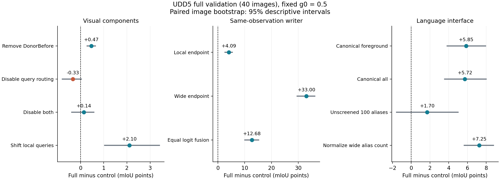
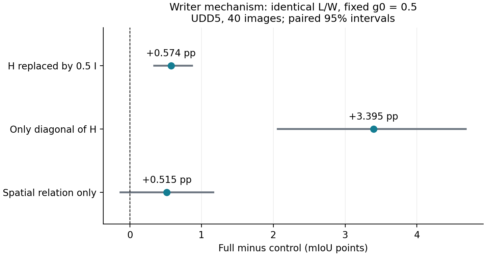

# UDD5：固定 g0=0.5 的完整部件消融

2026-10-14。完整验证集40张、5类，16个预声明对照。所有使用H的行固定g0=0.5；没有自适应gate，也没有针对消融重新选择词表、温度、阈值或背景偏置。

**Full：55.2574% mIoU，288.20 ms，峰值 allocated 2276.79 MiB。**
相对前轮55.2567% 的复现差为 +0.000666pp。所有40张唯一覆盖、分片配置和逐图混淆矩阵之和均已核验。

## 1. 完整模型与主消融

Full = 冻结31词＋局部DonorBefore＋宽视野24槽QuerySlot（beta=0.5，query温度0.1）＋Z=L+0.5H(W−L)。
H=(I+AᵀA)⁻¹AᵀA；局部strength=original，使DonorBefore确实执行。Full宽视野没有VIP proxy self-correction或salience；词表的VIP历史来源、冻结dino.txt骨干及接口兼容不等于把官方VIP作为模型部件。

| 配置 | mIoU % | Full−该行 pp | 配对95%区间 pp | 耗时 ms | allocated MiB |
| --- | ---: | ---: | --- | ---: | ---: |
| Full | 55.2574 | +0.0000 | [+0.0000, +0.0000] | 288.20 | 2276.79 |
| NoDonorBefore | 54.7910 | +0.4664 | [+0.2850, +0.6416] | 292.48 | 2276.79 |
| NoQueryRouting | 55.5846 | -0.3273 | [-0.7834, +0.0364] | 288.04 | 2276.79 |
| NoDonorNoRouting | 55.1164 | +0.1410 | [-0.3799, +0.5723] | 291.27 | 2276.79 |
| ShuffledQuery | 53.1533 | +2.1040 | [+1.0414, +3.3961] | 302.67 | 2276.79 |
| CanonicalForeground | 49.4028 | +5.8546 | [+3.8356, +7.9351] | 292.80 | 2276.57 |
| UnscreenedAliases | 53.5570 | +1.7003 | [-1.5700, +5.0008] | 292.43 | 2279.02 |
| WideCountNormalized | 48.0069 | +7.2505 | [+5.6620, +8.7818] | 293.92 | 2276.79 |
| EqualLogitFusion | 42.5775 | +12.6799 | [+10.0814, +15.2006] | 301.62 | 2244.27 |
| LocalOnly | 51.1651 | +4.0923 | [+2.6926, +5.4262] | — | — |
| WideOnly | 22.2534 | +33.0039 | [+29.5431, +36.1565] | — | — |

差值为Full减去对照；负数表示该对照更好。区间为10,000次配对图像bootstrap的百分位区间，不把像素当独立样本。40张较少，区间只描述这份已查看验证集的不确定性，不代表独立测试或跨数据集保证。

## 2. 如何解释各部件

主表的观察是：结构写回相对等权融合提高12.6799pp，保留背景不变的前景扩词提高5.8546pp。冻结Kev词表相对未筛候选池平均提高1.7003pp，但其配对区间跨过0，不能据此称为稳定筛词收益。
但Full比关闭路由低0.3273pp；Raw32坐标宽视野与旧VIP宽视野＋DonorBefore也分别达到55.7592%和56.2514%。因此不能写成QuerySlot在UDD5上是必需的精度模块，也不能仅凭打乱控制下降就宣称路由超过坐标基线。保留路由需要其他数据集或效率收益支持。

- 保留query路由时，DonorBefore的条件收益：+0.4664pp，95%区间[+0.2850, +0.6416]。
- 保留DonorBefore时，query路由的条件收益：-0.3273pp，95%区间[-0.7834, +0.0364]。
- 正确局部query对应相对循环移位控制：+2.1040pp，95%区间[+1.0414, +3.3961]。
- 保留同样背景时，入选前景扩词的净效果：+5.8546pp，95%区间[+3.8356, +7.9351]。
- 相同模板和背景下，Kev筛选31词相对未筛100词：+1.7003pp，95%区间[-1.5700, +5.0008]。
- 同一L/W下，结构写回相对等权logit融合：+12.6799pp，95%区间[+10.0814, +15.2006]。

DonorBefore×路由的差分交互为 -0.0019pp。部件贡献是条件收益，不能把各项删除差值直接相加当作总增益。

NoQueryRouting使用beta=0：24槽、宽视野head、局部裁窗、坐标特征采样、采样后归一化与计分顺序都保留，只不混入query选出的槽值。ShuffledQuery使用固定循环移位512个token（在32×32网格上相当于16行位移），保留query多重集，破坏对应位置；它是位置对应控制，不是随机多seed实验。
逐类来看，DonorBefore使五类IoU全部提高；query路由相对关闭路由使road IoU变化-1.5692pp、building变化-0.5311pp，是其均值下降的主要来源。等权融合vehicle IoU为4.9118%，Full为38.9066%。

## 3. Alias的控制与限制

当前Kev词数为[7,1,2,1,20]；CanonicalForeground为[1,1,1,1,20]；CanonicalAll为[1,1,1,1,1]；UnscreenedAliases为[20,20,20,20,20]。全部使用同一个seg_template及相同冻结文本编码，背景20词在前景扩词和筛词对照中完全不变。
局部Alias用温度0.07的log-mean-exp，之后除以固定局部校准温度0.05；宽视野使用40倍相似度和tau=1的log-sum-exp，没有除词数，也没有salience。WideCountNormalized只去掉宽视野log(词数)/tau偏置，不删词。
因此Full相对未筛词池的变化包含语义筛选与词数先验的共同效果；不能全部解释成Kev理解语义的收益。CanonicalAll会同时删掉19个背景概念，不能当作纯前景同义词消融。Kev阈值0.6和当前词表曾经用带标签开发数据选择，本轮只是冻结使用，不能称为完全无标签开发。

## 4. 历史宽视野与容量参考

| 配置 | mIoU % | 耗时 ms | allocated MiB |
| --- | ---: | ---: | ---: |
| Raw24CoordinateGrid | 55.7535 | 293.73 | 2254.51 |
| Raw32CoordinateGrid | 55.7592 | 284.45 | 2254.51 |
| LegacyGeometryVIPWide | 55.8266 | 322.74 | 2257.36 |
| LegacyDonorVIPWide | 56.2514 | 304.80 | 2257.36 |
| CanonicalAll | 49.5336 | 291.30 | 2275.97 |

Raw24/Raw32先在宽视野整图坐标网格计分，再向局部采样分数；Full和NoQueryRouting先采样/混合特征再计分，非线性Alias聚合与归一化不一定与采样交换。所以不能把Full−Raw32全归因于query路由；主路由结论应看Full−NoQueryRouting。Raw24与Raw32之间则只改变槽容量。
LegacyGeometryVIPWide与LegacyDonorVIPWide是历史模型内部宽视野替换对照：long448、crop336/stride224、相同31词与g0=0.5。它们含有局部分支和结构写回，绝不是官方VIP完整模型。VIP原生滑窗stride112且有自己的配置，UDD5也没有官方配置；本轮没有把旧VIP宽视野冒充官方VIP外部基线。

## 5. 逐类结果

| 配置 | vegetation | building | road | vehicle | other |
| --- | ---: | ---: | ---: | ---: | ---: |
| Full | 79.2195 | 84.6043 | 36.4958 | 38.9066 | 37.0605 |
| NoDonorBefore | 78.6756 | 84.0797 | 35.6705 | 38.8107 | 36.7185 |
| NoQueryRouting | 79.2168 | 85.1354 | 38.0650 | 38.7412 | 36.7647 |
| NoDonorNoRouting | 78.7053 | 84.6124 | 37.3341 | 38.5191 | 36.4110 |
| ShuffledQuery | 77.5080 | 81.6569 | 33.3808 | 37.5965 | 35.6245 |
| CanonicalForeground | 52.6542 | 81.9778 | 43.3437 | 38.3211 | 30.7170 |
| UnscreenedAliases | 66.5881 | 81.4307 | 55.8870 | 34.2096 | 29.6698 |
| WideCountNormalized | 73.3926 | 73.3671 | 38.6567 | 24.3613 | 30.2568 |
| EqualLogitFusion | 79.0350 | 73.5069 | 21.4430 | 4.9118 | 33.9906 |
| LocalOnly | 73.9915 | 81.0842 | 45.1043 | 22.4025 | 33.2431 |
| WideOnly | 70.0670 | 16.8624 | 1.8227 | 0.0000 | 22.5149 |

## 6. 结构与修正幅度的同观测补充对照

这组控制在看过主消融表后另行预声明并运行，协议保存在writer_controls_protocol.json。使用同一L/W和g0=0.5：IsotropicHalfH将H替换为0.5I（即0.75L+0.25W），DiagonalH只保留H对角项，SpatialH用纯空间Gaussian关系代替视觉＋空间A来构造H。它们不重选步长或语言参数。
0.5I仅是预声明的固定减幅对照，并非证明它与H谱界或能量完全匹配。Full和EqualLogitFusion在这次重新编码的观测上重新计分，比较应使用此补充表内部差值。

| 写回 | mIoU % | Full−该行 pp | 配对95%区间 pp |
| --- | ---: | ---: | --- |
| Full | 55.2566 | +0.0000 | [+0.0000, +0.0000] |
| EqualLogitFusion | 42.5743 | +12.6823 | [+10.0834, +15.2008] |
| IsotropicHalfH | 54.6826 | +0.5740 | [+0.3386, +0.8650] |
| DiagonalH | 51.8616 | +3.3950 | [+2.0609, +4.6823] |
| SpatialH | 54.7418 | +0.5148 | [-0.1299, +1.1611] |

全量有效patch的平均H对角为0.031353；修正与差分的RMS比 ||H(W−L)||/||W−L||=0.474746。这些量仅作无标签机制诊断，不用于选参。
Full相对固定减幅融合提高0.5740pp且区间不含0，相对仅对角H提高3.3950pp且区间不含0，支持跨位置结构写回超越单纯固定减幅。Full相对纯空间H提高0.5148pp，但区间包含0，因此视觉关系相对空间先验的额外贡献仍需更多数据；不宣称已经证明其不可替代。

## 7. 成本和数值边界

A800，batch=1；所有成本配置在同一张GPU1顺序执行，完整精度作业结束后才开始。每个配置独立新进程，只保留该行语言bank；同一7张固定图，每图2次预热、7次CUDA同步重复。耗时为49次中位数，显存为CUDA max_memory_allocated峰值；reserved另存于JSON/CSV。
计时包含CPU float RGB输入后的缩放、全部视觉编码、分支读出、H求解（如使用）、原尺寸恢复和CPU uint8输出；排除解码、模型初始化、离线文本编码及标签。等权融合的独立成本省去不用的H求解。两个视觉模型按现有部署常驻，没有以多消融共驻显存冒充单模型成本。端点只评精度，未作为独立部署优化后计时。
NoQueryRouting/NoDonorNoRouting在当前函数中以beta=0关闭输出路由，仍计算未混入的槽路由中间量；它们的时延是该控制实现的实测成本，不代表彻底删除路由计算后的最小成本。三项补充H控制只做同观测精度评测，未作为部署模型单独计时。
顺序成本存在运行状态波动；例如Raw24/Raw32的槽数差不能据本轮数毫秒差值推断理论加速，去H的等权融合也没有测得更低中位延迟。小幅时延差只报告实测值，不宣称稳定速度收益。
CUDA槽聚类的index_add累加有微小重复编码差异；smoke检查在同一观测下与FrozenGeometry.predict逐像素一致，并保留重新编码的像素差异记录。Full全量与前轮复现差见开头，不将这种小数值波动解释为部件贡献。

## 8. 论文用途

UDD5适合承担一套完整部件消融，证明这些机制在本数据集上的条件效果。论文若要声称部件对遥感和自然图像普遍有效，应至少补一个自然协议的关键行；无需把16行全部重跑所有数据集。十协议统一g0主表仍应保留，避免仅凭UDD5这一效果较强协议宣称普遍优势。

复现入口：[评测脚本](../../DINOtool/scripts/eval_geov2_udd5_fixed05.py)、[H控制脚本](../../DINOtool/scripts/eval_geov2_udd5_writer_controls.py)、[统计和作图](../../tools/report_udd5_fixed05_ablation.py)。
在已配置项目和模型依赖的环境中，将protocol.json中的数据/检查点/文本cache路径改为自己的路径，设置PYTHONPATH包含DINOtool、DINOtool/scripts和固定DINO_Soars依赖；运行评测脚本 --experiment 本目录 --mode full。使用 --mode cost --arm Full 运行独立成本。四分片及顺序成本的实际A800命令也保留于full.sh和cost.sh；输出目录存在时脚本拒绝覆盖。
数据：[SUMMARY.json](SUMMARY.json)、[RESULTS.csv](RESULTS.csv)、[逐图混淆矩阵](per_image_confusions.npz)、[冻结协议](protocol.json)、full/与cost/。
