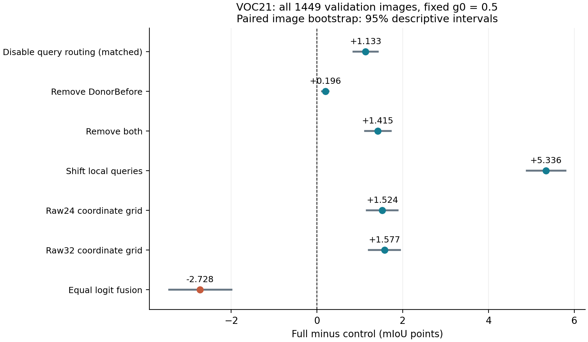
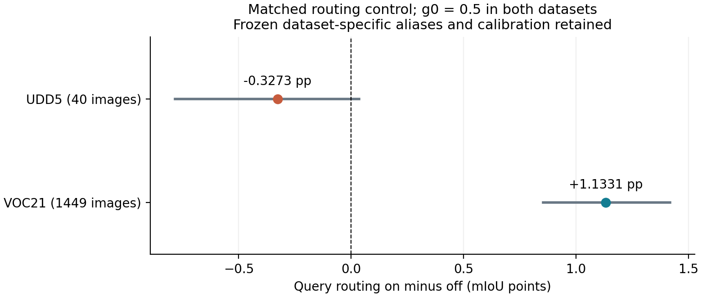

# VOC21：固定 g0=0.5 的 QuerySlot 复核与部件消融

**Full：72.1656% mIoU；关闭query路由：71.0325%；净差 +1.1331pp，配对95%区间 [+0.8550, +1.4184]。**

本轮支持QuerySlot在VOC21当前配置下有净收益。

2026-10-14。UDD5之后事先选择VOC21作为自然图像复核，完整验证集1,449张、21类；13项对照，不筛图、不在本轮改alias、beta、g0或背景校准。所有结构写回行固定g0=0.5，无自适应gate。UDD5负向路由结果一并保留。

## 1. 本轮完整模型与协议

Full = 冻结official_segmentation词表＋局部DonorBefore＋整图24槽QuerySlot（raw query，beta=0.5、温度0.1）＋Z=L+0.5H(W−L)。H=(I+AᵀA)⁻¹AᵀA。局部strength=original，确保DonorBefore实际执行。
词表共119词，其中背景56词。VOC21这份词表来自官方分割词表及历史开发配置，不能称作本轮Kev筛词结果。CanonicalForeground保留同一背景56词，仅将20个前景类别各缩为类名，共76词。WideCountNormalized只修改宽视野按类聚合时的词数项。
自然宽视野沿用natural_short336_cap672；局部温度0.07、宽视野tau=1、背景union_max、bias=-0.25、threshold=0.15均不变。原10/13配置coupling=0.75，本轮显式冻结为0.5，其余历史任务参数仍不是全数据集统一配置。
Full宽视野没有VIP proxy self-correction或salience。LegacyDonorVIPWide只是将内部宽视野替换成旧VIP来源分支，不能当作官方完整VIP对比。骨干及文本来源的归属与模型部件应分开说明。

## 2. 全量结果

| 配置 | mIoU % | Full−该行 pp | 配对95%区间 pp | 中位耗时 ms | allocated MiB |
| --- | ---: | ---: | --- | ---: | ---: |
| Full | 72.1656 | +0.0000 | [+0.0000, +0.0000] | 142.47 | 2247.24 |
| NoDonorBefore | 71.9698 | +0.1958 | [+0.1189, +0.2738] | 140.69 | 2247.24 |
| NoQueryRouting | 71.0325 | +1.1331 | [+0.8550, +1.4184] | 140.12 | 2247.24 |
| NoDonorNoRouting | 70.7506 | +1.4150 | [+1.1204, +1.7187] | — | — |
| ShuffledQuery | 66.8297 | +5.3359 | [+4.8896, +5.7914] | 139.98 | 2247.24 |
| CanonicalForeground | 68.0817 | +4.0839 | [+3.3596, +4.8055] | — | — |
| WideCountNormalized | 59.8508 | +12.3148 | [+11.6029, +13.0406] | — | — |
| EqualLogitFusion | 74.8935 | -2.7279 | [-3.4463, -1.9927] | — | — |
| LocalOnly | 41.4698 | +30.6958 | [+29.3144, +31.9927] | — | — |
| WideOnly | 70.9986 | +1.1670 | [+0.0148, +2.3980] | — | — |
| Raw24CoordinateGrid | 70.6414 | +1.5242 | [+1.1620, +1.8809] | 136.92 | 2178.25 |
| Raw32CoordinateGrid | 70.5888 | +1.5768 | [+1.2086, +1.9396] | 139.43 | 2178.25 |
| LegacyDonorVIPWide | 72.1035 | +0.0621 | [-0.4799, +0.5988] | 163.68 | 2180.69 |

差值为Full减对照，负数表示对照更好。mIoU由全量合并混淆矩阵计算，不是逐图mIoU平均。区间使用10,000次配对图像bootstrap，同一次抽样对所有方法使用相同图像权重，不把像素当独立样本；它们是已查看验证集上的描述性区间，无多重比较校正。

## 3. QuerySlot究竟是否有效

需要区分三个不同问题：正确query是否比错误query好、加入路由是否比关闭路由好、QuerySlot实现是否比Raw坐标网格好。只有第二个是本轮主要的路由净贡献检验。

| 检验 | 差值 pp | 配对95%区间 pp |
| --- | ---: | --- |
| Full−NoQueryRouting（主检验） | +1.1331 | [+0.8550, +1.4184] |
| NoDonorBefore−NoDonorNoRouting | +1.2192 | [+0.9555, +1.4901] |
| Full−ShuffledQuery | +5.3359 | [+4.8896, +5.7914] |
| Full−Raw24CoordinateGrid | +1.5242 | [+1.1620, +1.8809] |
| Full−Raw32CoordinateGrid | +1.5768 | [+1.2086, +1.9396] |
| Raw32CoordinateGrid−Raw24CoordinateGrid | -0.0526 | [-0.0716, -0.0338] |
| Full−NoDonorBefore | +0.1958 | [+0.1189, +0.2738] |
| NoQueryRouting−NoDonorNoRouting | +0.2819 | [+0.1962, +0.3715] |
| DonorBefore×routing的2×2交互 | -0.0861 | [-0.1351, -0.0388] |

NoQueryRouting保留同一24槽、同一局部query来源、同一整图特征采样顺序，仅beta=0使路由值不混入预测。ShuffledQuery保留局部query多重集合，按512位循环移位打破query与输出位置对应；正确比打乱好只能证明空间对应有作用，不能替代关闭路由对照。
Raw24/Raw32先在整图网格计分再采样；Full与NoQueryRouting先在局部位置采样特征、归一化，再计分。采样、归一化和非线性类聚合不能随意交换，因此Full−Raw24/32包含采样顺序与容量差异，不能全部归因于query路由。

Query路由使21类中17类IoU提高、4类下降。按变化排序的前三类与后三类如下；其余类别完整列于RESULTS.csv。

| 类别 | 路由开启−关闭的类别IoU pp |
| --- | ---: |
| bottle | +5.9418 |
| person | +5.5470 |
| horse | +4.4884 |
| aeroplane | -2.8715 |
| train | -4.4656 |
| bird | -5.9531 |

## 4. 为什么之前说过QuerySlot有用

历史正向证据存在，但适用配置必须写清楚：

- [10/13十域开发筛查](../QUERY_SLOT_WIDE_20261013.md)：每域16图，32槽QuerySlot_Raw 53.7964%对Memory32_Raw 53.6474%，宏平均+0.1490pp，配对95%区间[-0.3161,+0.5832]；QuerySlot＋DonorBefore为53.9444%，相对Raw32 +0.2970pp，区间[-0.1740,+0.7757]。后一个差值还混合DonorBefore变化。
- [历史全量VOC20消融](../geov2_full_ablation_20261014/REPORT.md)：QuerySlot_Raw 92.1652%对Raw24Slots 90.9828%，+1.1824pp；旧adaptive配置92.2111%对NoRoutingAdaptive 91.2746%，+0.9365pp。但局部strength=1、DonorBefore不执行，且包含自适应写回，不等于本轮固定g0、strength=original配置。
- [UDD5固定0.5全量](../geov2_udd5_fixed05_ablation_20261014/REPORT_ZH.md)：Full 55.2574%对关闭路由55.5846%，−0.3273pp；正确query显著优于打乱query，但没有证明加入路由优于不加入。

因此“以前有正向证据”成立，“每个域、每套参数都必然获益”不成立。本轮不以换数据集为由删除UDD5结果，也不把VOC20旧配置的收益搬到当前VOC21。

## 5. Alias、写回与效率的独立解释

保留背景不变的前景扩词：+4.0839pp，配对95%区间[+3.3596, +4.8055]。
固定结构写回相对同观测等权融合：-2.7279pp，配对95%区间[-3.4463, -1.9927]。

Full相对Raw32坐标读出增加3.04ms（2.18%）和68.99MiB allocated；相应mIoU提高1.5768pp，但该精度差还包含采样顺序变化。

不能把Alias收益自动归为Kev筛词收益：本轮没有为VOC21定义与当前词表同来源、同模板、同背景的未筛候选池。词数归一化控制测试聚合规则，不等价于词表筛选。
这两份全量消融可分别支撑机制，但不能宣称每个部件在每个域都提高：UDD5固定写回胜过等权融合，而VOC21主要展示query路由的收益。VOC21当前固定0.5写回低于等权融合，说明统一步长在自然图像上仍有取舍。上一轮同配置g0扫描中，VOC21的g0=0.75为74.6881%、g0=1为75.2094%；这些只作已查看参数敏感性的历史参考，不替换本轮预先固定0.5的消融结果，也不算独立泛化证据。
耗时为A800上7张预先固定图、每张2次预热＋7次同步计时的合并中位数。每个arm独立进程，在精度作业结束后顺序运行；边界为CPU float RGB输入到原尺寸CPU uint8类ID，排除解码、初始化、离线文本编码和mask。显存为PyTorch峰值allocated，reserved另见CSV/JSON，不能与nvidia-smi驻留值混用。
NoQueryRouting仍计算未混入的路由中间量，其成本用于控制当前执行路径，不代表彻底删除query计算后的最优速度。当前脚本不以全量精度评测墙钟时间替代单图延迟。

## 6. 复现、来源和核验

Full相对上一轮完整g0扫描的72.165567%复现差为+0.000023pp。所有1,449张唯一覆盖、7个分片的元数据和逐图混淆矩阵之和均已核验，并与旧全量标签支持数一致。
同观测实验接口与FrozenGeometry.predict差异为0像素；重新编码首图有19个像素变化（0.010383%），记录CUDA槽归约顺序产生的浮点波动。

历史Alias、温度和背景参数用过带标签开发集，且此前查看过全量验证；本轮推理不读取标签，标签只在全部预测完成后用于评分。冻结复核不等于独立测试，不能声明无标签开发选择。
入口：[通用评测](../../DINOtool/scripts/eval_geov2_fixed05_components.py)、[审计统计和作图](../../tools/report_voc21_fixed05_ablation.py)。配置和实际词表位于[configs/voc21.yaml](configs/voc21.yaml)、[vocabularies/voc21.json](vocabularies/voc21.json)。YAML保留历史coupling=0.75，本轮覆盖值以protocol.json与结果profile中的0.5为准。
在已配置DINOtool及固定上游依赖的环境中，将protocol.json中的数据、checkpoint及文本cache路径换成本机路径，设置PYTHONPATH包含DINOtool、DINOtool/scripts及DINO_Soars依赖。运行eval_geov2_fixed05_components.py --experiment 本目录 --mode full；成本使用--mode cost --arm Full。实际七分片及顺序成本命令见full.sh、cost.sh。输出已存在时脚本拒绝覆盖。
证据：[SUMMARY.json](SUMMARY.json)、[RESULTS.csv](RESULTS.csv)、[逐图混淆矩阵](per_image_confusions.npz)、[冻结协议](protocol.json)、full/及cost/；历史对照来源保留在reference/。权重、图像、mask、二进制文本缓存与SSH配置不发布。
